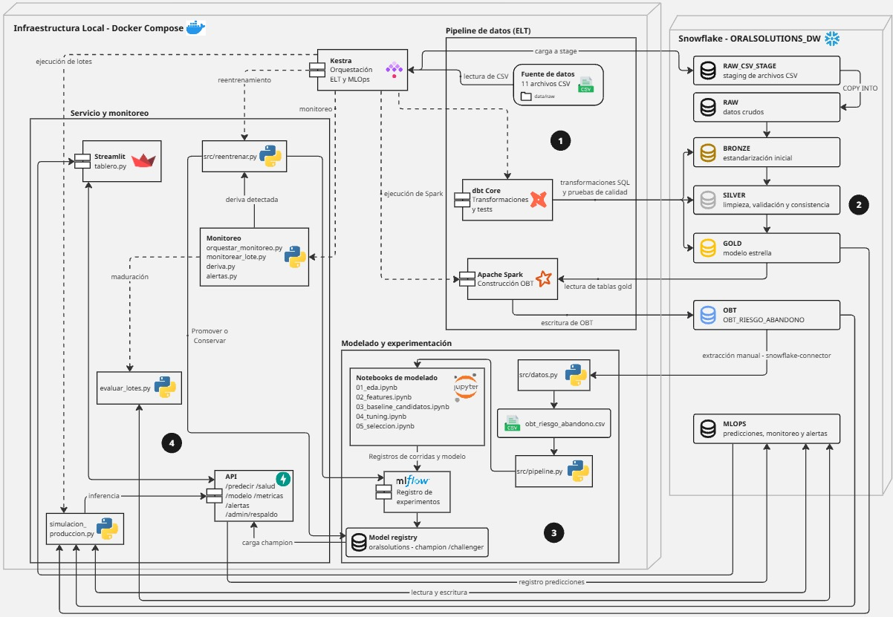

# OralSolutions — Predicción de abandono de tratamientos odontológicos

Proyecto end-to-end de ciencia de datos para una clínica odontológica simulada. Estima el riesgo de que un paciente con sesiones pendientes no continúe su tratamiento durante los 60 días posteriores a una sesión atendida, para apoyar al personal de recepción en la priorización de contactos preventivos y reprogramaciones.

**Métrica de éxito:** incrementar la continuidad a 60 días en 10 puntos porcentuales respecto al seguimiento reactivo (meta aspiracional, no resultado clínico observado). El modelo se selecciona por el costo estimado de errores `C = 120 × FN + 3 × FP`, con Average Precision (AP, denominada PR-AUC en el proyecto) como métrica técnica principal. El umbral operativo definitivo es **0,01**: a partir de ese valor se recomienda contactar al paciente, bajo supervisión humana.



**Orden de ejecución:** preparar y obtener los datos → ejecutar el pipeline ELT → entrenar y registrar el modelo → levantar el servicio → simular, monitorear y evaluar el reentrenamiento. Si ya existe una etapa completada, se puede continuar desde la siguiente sin repetirla. Los CSV de `docs/` son evidencias históricas, no reemplazan las tablas de Snowflake ni los artefactos de MLflow.

## Datos

Se utiliza un dataset sintético de 11 CSV, 38.603 registros y 69 columnas distribuidas entre las fuentes, con histórico 2024–2025. Se elaboró tomando como referencia *Dental Clinic Appointments and Billing Dataset* de DatabaseSample (2026), adaptado a OralSolutions; no contiene historias clínicas reales.

Todos los archivos se obtienen de la [carpeta de Google Drive de OralSolutions](https://drive.google.com/drive/folders/1bDd9OOZ1SPTLjnGQld5IIn-x4Gp8KQIh?usp=drive_link). Los catálogos no tienen necesariamente fecha propia; el período corresponde al histórico operativo del conjunto.

| Fuente | Qué contiene (filas × columnas) | Cómo se obtiene | Dónde queda |
|---|---|---|---|
| Citas | 7.788 × 6; paciente, odontólogo, fecha, tipo y cobertura | Google Drive / `src/ingestar.py` | `data/raw/appointments.csv` |
| Odontólogos | 5 × 5; identificación, contrato y fecha de ingreso | Google Drive / script | `data/raw/dentists.csv` |
| Aseguradoras | 4 × 4; esquema, plan y cobertura | Google Drive / script | `data/raw/insurers.csv` |
| Facturas | 7.788 × 6; cita, emisión, estado y pago | Google Drive / script | `data/raw/invoices.csv` |
| Citas perdidas | 1.500 × 5; paciente, odontólogo, fecha y resultado | Google Drive / script | `data/raw/missed_appointments.csv` |
| Seguimientos | 1.243 × 5; plan, fecha, método y resultado del contacto | Google Drive / script | `data/raw/patient_followups.csv` |
| Pacientes | 2.500 × 8; identificación, nacimiento, cobertura y registro | Google Drive / script | `data/raw/patients.csv` |
| Procedimientos | 10 × 6; código, nombre, tarifa y duración | Google Drive / script | `data/raw/procedures.csv` |
| Líneas de tratamiento | 7.956 × 6; cita, procedimiento e importes | Google Drive / script | `data/raw/treatment_lines.csv` |
| Planes de tratamiento | 3.015 × 10; paciente, procedimiento, sesiones, estado y fechas | Google Drive / script | `data/raw/treatment_plans.csv` |
| Sesiones de tratamiento | 6.794 × 8; plan, cita, número, fechas y estado | Google Drive / script | `data/raw/treatment_sessions.csv` |
| **Total** | **38.603 filas / 69 columnas acumuladas** | | |

### Obtener el repositorio y preparar Python

Requisitos: Git, Python 3.14.6 (entorno local verificado), Internet, Docker con Compose y contenedores Linux, cuenta Snowflake con permisos suficientes y VS Code con extensiones Python/Jupyter o equivalente.

Desde GitHub, copiar la URL del repositorio en **Code → HTTPS**. Sustituir el marcador por la URL copiada:

```powershell
git clone https://github.com/Satiban/proyecto_final.git
cd proyecto_final
python --version
python -m venv .venv
.\.venv\Scripts\Activate.ps1
python -m pip install -r requirements.txt
```

En Linux, usar `python3 -m venv .venv` y `source .venv/bin/activate`. Los ejemplos siguientes utilizan PowerShell y se ejecutan desde la raíz `proyecto_final/` (donde está `docker-compose.yml`), salvo los SQL, que se ejecutan en Snowsight, y los flujos, que se ejecutan en Kestra.

El `requirements.txt` raíz contiene las dependencias de desarrollo y notebooks; `api/requirements.txt` contiene las de API y tareas MLOps. dbt y Spark se ejecutan en Docker. Mantener versiones compatibles con `tests/fixtures/modelo_champion/requirements.txt`, especialmente scikit-learn, NumPy y pandas, para cargar el artefacto serializado. La verificación local se describe en «Cómo correr el servicio» y puede ejecutarse antes de configurar Snowflake.

### Descargar los datos

Con `.venv` activo:

```powershell
python src/ingestar.py
```

El script crea `data/raw/`, verifica los 11 archivos esperados y descarga desde Google Drive cuando falta alguno. Resultado de referencia: 11 CSV y 38.603 registros. Si falla la descarga automática, descargar manualmente los archivos del enlace anterior, colocarlos directamente en `data/raw/` y repetir el comando. Kestra también invoca este script durante la ingesta.

Los CSV crudos y procesados no se versionan en Git. Se recupera el dataset original desde Drive, no se vuelve a generar aleatoriamente. El conjunto etiquetado se reconstruye en la etapa de modelado.

## Cómo correr el pipeline de datos

**Flujo ELT:** Google Drive → Kestra → Snowflake RAW → dbt Bronze/Silver/Gold → Spark → Snowflake OBT. PostgreSQL conserva el estado de Kestra. El diagrama dimensional está disponible en [docs/modelo_dimensional.png](docs/modelo_dimensional.png).

### Estructura del proyecto

Árbol de los archivos del repositorio según el inventario revisado, excluyendo los archivos obsoletos identificados durante la auditoría. Las carpetas de datos se crean durante la ejecución y los dos PDF del PSet4 corresponden a la entrega final.

```text
proyecto_final/
├── .github/                              # Automatización de CI/CD
│   └── workflows/
│       ├── cd.yml                        # Construcción y publicación de la API en GHCR
│       └── ci.yml                        # Validación mediante pruebas automatizadas
├── api/                                  # Servicio de predicción con FastAPI
│   ├── __init__.py
│   ├── Dockerfile                        # Imagen Docker del servicio
│   ├── esquemas.py                       # Contratos y validaciones con Pydantic
│   ├── exportar_modelo.py                # Exportación del champion para pruebas locales
│   ├── main.py                           # Endpoints, inferencia, persistencia y respaldo
│   └── requirements.txt                  # Dependencias de API y tareas MLOps
├── calidad/                              # Diagnóstico y limpieza de datos
│   ├── diagnostico_proyecto.ipynb        # Evaluación de calidad de las fuentes originales
│   └── limpiar.py                        # Ejecución de transformaciones y pruebas Silver
├── config/                               # Plantillas de configuración
│   └── dbt/
│       └── profiles.example.yml          # Plantilla de conexión dbt–Snowflake
├── data/                                 # Datos locales excluidos de Git
│   ├── processed/                        # Dataset etiquetado generado para modelado
│   └── raw/                              # Once archivos CSV descargados de Google Drive
├── dbt/                                  # Transformaciones ELT y pruebas de calidad
│   ├── macros/
│   │   └── generate_schema_name.sql      # Personalización de esquemas en Snowflake
│   ├── models/                           # 28 modelos de transformación
│   │   ├── bronze/                       # Tipificación y estandarización
│   │   ├── gold/                         # Dimensiones y tabla de hechos
│   │   └── silver/                       # Limpieza, normalización y consistencia
│   ├── tests/                            # Pruebas personalizadas de calidad
│   │   ├── gold/                         # Validaciones del modelo dimensional
│   │   └── silver/                       # Validaciones de datos normalizados
│   ├── .gitignore
│   └── dbt_project.yml                   # Configuración general de dbt
├── docs/                                 # Documentación y evidencias experimentales
│   ├── historial/                        # Entregables históricos corregidos
│   │   ├── PSet1_memo_Tiban.pdf
│   │   ├── PSet1_pitch_Tiban.pdf
│   │   ├── PSet2_memo_Tiban.pdf
│   │   └── PSet3_memo_Tiban.pdf
│   ├── alertas.csv                       # Alertas generadas durante el monitoreo
│   ├── arquitectura.png                  # Diagrama de arquitectura end-to-end
│   ├── cambios.md                        # Registro de correcciones y ajustes
│   ├── corridas.csv                      # Historial consolidado de corridas MLflow
│   ├── deriva_features.csv               # Métricas de deriva por predictor
│   ├── equidad.csv                       # Evaluación de desempeño por subgrupos
│   ├── lotes_produccion.csv              # Control y maduración de lotes simulados
│   ├── modelo_dimensional.png            # Diagrama del esquema estrella
│   ├── monitoreo.csv                     # Métricas supervisadas y costos por lote
│   ├── monitoreo_inmediato.csv           # Métricas operativas sin etiquetas maduras
│   ├── predicciones.csv                  # Predicciones de producción simulada
│   ├── predicciones_demostracion.csv     # Evidencias de rollback y respaldo
│   ├── PSet4_memo_Tiban.pdf               # Documento técnico integral
│   ├── PSet4_presentacion_Tiban.pdf       # Presentación ejecutiva final
│   ├── reentrenamientos.csv              # Corridas y decisiones de promoción
│   ├── resultados_modelos.csv            # Comparación de líneas base y candidatos
│   ├── resultados_seleccion.csv          # Evaluación y selección del champion
│   ├── resultados_tuning.csv             # Resultados de optimización de hiperparámetros
│   └── solicitudes_http.csv              # Telemetría HTTP de producción simulada
├── kestra/                               # Flujos de orquestación ELT y MLOps
│   ├── backfill_oralsolutions.yml        # Recuperación histórica parametrizada
│   ├── ingest_raw_oralsolutions.yml      # Descarga y carga idempotente en RAW
│   ├── ingesta.yml                       # Flujo maestro ELT con programación diaria
│   ├── monitoreo.yml                     # Monitoreo inmediato y supervisado
│   ├── produccion_lotes.yml              # Simulación de inferencia por lote
│   ├── reentrenamiento.yml               # Entrenamiento y aprobación humana
│   ├── simulacion_completa.yml           # Orquestación secuencial de lotes L04–L14
│   ├── test_dbt_docker.yml               # Ejecución de modelos y pruebas dbt
│   └── test_spark_docker.yml             # Construcción de la OBT mediante Spark
├── monitoreo/                            # Simulación, observabilidad y operación MLOps
│   ├── alertas.py                       # Reglas, severidades y registro de alertas
│   ├── deriva.py                        # Cálculo de PSI, KS y chi-cuadrado
│   ├── evaluar_lotes.py                 # Evaluación de lotes con etiquetas maduras
│   ├── monitorear_lote.py               # Monitoreo inmediato de calidad y deriva
│   ├── orquestar_monitoreo.py            # Coordinación de las etapas de monitoreo
│   ├── simular_produccion.py             # Simulación histórica mediante la API
│   └── tablero.py                       # Dashboard Streamlit y panel de recepción
├── notebooks/                            # Experimentación y análisis reproducible
│   ├── 01_eda.ipynb                      # Análisis exploratorio de datos
│   ├── 02_features.ipynb                 # Ingeniería de variables y ablación
│   ├── 03_baseline_candidatos.ipynb      # Comparación de modelos y prueba con Ollama
│   ├── 04_tuning.ipynb                   # Optimización de hiperparámetros
│   ├── 05_seleccion.ipynb                # Evaluación final y registro de modelos
│   ├── 06_simulacion_produccion.ipynb    # Consulta y exportación de predicciones
│   └── 07_analisis_monitoreo.ipynb       # Análisis de deriva, equidad, costos y reentrenamiento
├── scripts/                              # Utilidades de demostración
│   └── demostrar_rollback.py            # Cambio y restauración de versiones del modelo
├── spark/                                # Procesamiento analítico con Apache Spark
│   ├── job_spark.py                     # Integración dimensional y construcción de la OBT
│   └── verificar_conexion.py            # Comprobación de conectividad con Snowflake
├── sql/                                  # Inicialización de estructuras en Snowflake
│   ├── mlops/                            # Esquema operativo de MLOps
│   │   ├── 01_crear_predicciones.sql     # Registro de predicciones individuales
│   │   ├── 02_preparar_simulacion.sql    # Trazabilidad y control de lotes
│   │   ├── 03_crear_monitoreo.sql        # Métricas supervisadas por lote
│   │   ├── 04_crear_monitoreo_inmediato.sql # Métricas inmediatas, deriva y alertas
│   │   └── 05_crear_telemetria_http.sql   # Registro de solicitudes HTTP
│   ├── 01_setup_snowflake.sql            # Creación de warehouse, base y esquemas
│   └── 02_create_raw_tables.sql          # Creación de tablas RAW, stage y formato CSV
├── src/                                  # Lógica reutilizable del proyecto
│   ├── __init__.py
│   ├── datos.py                         # Extracción y construcción del target a 60 días
│   ├── ingestar.py                      # Descarga y verificación de fuentes CSV
│   ├── pipeline.py                      # Features, preprocesamiento y división temporal
│   └── reentrenar.py                    # Reentrenamiento, evaluación y promoción
├── tests/                                # Suite de 33 pruebas automatizadas
│   ├── fixtures/                         # Artefactos fijos para pruebas independientes
│   │   ├── modelo_champion/              # Modelo histórico exportado desde MLflow
│   │   │   ├── conda.yaml                # Especificación del entorno Conda
│   │   │   ├── input_example.json       # Ejemplo de entrada del modelo
│   │   │   ├── MLmodel                  # Metadatos y configuración MLflow
│   │   │   ├── model.pkl                # Pipeline del modelo serializado
│   │   │   ├── python_env.yaml           # Especificación del entorno Python
│   │   │   ├── requirements.txt          # Dependencias del modelo exportado
│   │   │   └── serving_input_example.json # Ejemplo de entrada para inferencia
│   │   ├── modelo_meta.json              # Identidad, métricas y umbral del champion
│   │   └── muestra_test.csv              # 826 observaciones del hold-out
│   ├── __init__.py
│   ├── test_comportamiento.py           # Consistencia, respaldo y seguridad administrativa
│   ├── test_contrato.py                 # Validación de entradas y respuestas HTTP
│   ├── test_firma_mlflow.py             # Compatibilidad Pydantic–Pipeline–MLflow
│   ├── test_modelo.py                   # Reproducibilidad del modelo y sus métricas
│   └── test_pipeline.py                 # Features, preprocesamiento y separación temporal
├── .env.example                          # Plantilla de variables de entorno
├── .gitignore                            # Exclusión de credenciales y archivos locales
├── conftest.py                           # Configuración compartida de pytest
├── docker-compose.yml                    # Definición de servicios, redes y volúmenes
├── Dockerfile.dbt                        # Imagen personalizada de dbt Core
├── README.md                             # Guía de configuración, ejecución y reproducción
└── requirements.txt                      # Dependencias generales de Python
```

Los directorios `data/raw/` y `data/processed/`, los archivos privados `.env` y `config/dbt/profiles.yml`, los logs, cachés, entornos virtuales y artefactos de ejecución no se versionan. La excepción es el modelo exportado en `tests/fixtures/`, necesario para ejecutar las pruebas sin MLflow ni Snowflake. Para comprobar el inventario real del checkout, ejecutar `git ls-files` desde la raíz.

### 1. Configurar Snowflake y credenciales

Para una instalación nueva, usar recursos aislados de otras ejecuciones del proyecto. Los scripts emplean nombres fijos de base de datos y esquemas. No borrar tablas, snapshots ni volúmenes de una ejecución histórica para volver a demostrar el proyecto.

Abrir Snowsight y ejecutar en orden:

| Archivo | Resultado |
|---|---|
| `sql/01_setup_snowflake.sql` | Warehouse `COMPUTE_WH`, base `ORALSOLUTIONS_DW` y esquemas `RAW`, `BRONZE`, `SILVER`, `GOLD`, `OBT`. |
| `sql/02_create_raw_tables.sql` | 11 tablas RAW, formato `CSV_RAW_FORMAT` y stage `RAW.RAW_CSV_STAGE`. |

Se requiere una cuenta Snowflake con los permisos correspondientes. El entorno académico usa `ACCOUNTADMIN`; para producción se recomienda un rol de privilegios mínimos. Las operaciones pueden consumir créditos de Snowflake.

Crear los archivos de configuración privados, únicamente si no existen:

```powershell
Copy-Item .env.example .env
Copy-Item config/dbt/profiles.example.yml config/dbt/profiles.yml
```

En Linux, usar `cp`. Completar `.env` conforme a su plantilla:

| Variable | Valor o configuración |
|---|---|
| `KESTRA_DB_PASSWORD` | Contraseña de PostgreSQL local. |
| `KESTRA_ADMIN_EMAIL`, `KESTRA_ADMIN_PASSWORD` | Acceso local a Kestra. |
| `ENV_SNOWFLAKE_URL` | `jdbc:snowflake://<IDENTIFICADOR_CUENTA>.snowflakecomputing.com` |
| `ENV_SNOWFLAKE_USER`, `SF_USER` | Usuario Snowflake. |
| `SF_ACCOUNT` | Identificador de cuenta, sin protocolo ni dominio. |
| `SECRET_SNOWFLAKE_PASSWORD`, `SF_PASSWORD` | Contraseña Snowflake en Base64 UTF-8 (repetir el valor conforme a la plantilla). |
| `SNOWFLAKE_ROLE`, `SF_ROLE` | `ACCOUNTADMIN` en el entorno académico. |
| `SNOWFLAKE_WAREHOUSE`, `SF_WAREHOUSE` | `COMPUTE_WH` |
| `SNOWFLAKE_DATABASE`, `SF_DATABASE` | `ORALSOLUTIONS_DW` |
| `SNOWFLAKE_SCHEMA` | `RAW` |
| `SF_GOLD_SCHEMA`, `SF_OBT_SCHEMA`, `SF_MLOPS_SCHEMA` | `GOLD`, `OBT`, `MLOPS`, respectivamente. |
| `ENV_KESTRA_HOST_PROJECT_PATH` | Ruta absoluta del repositorio visible para Docker. |
| `ADMIN_TOKEN`, `MODO_RESPALDO` | Token privado y `false`. |
| `API_IMAGE`, `API_PULL_POLICY` | `proyecto_final-api:latest`, `build`. |

Generar la contraseña Base64 y el token administrativo con:

```powershell
python -c "import base64,getpass; print(base64.b64encode(getpass.getpass('Contraseña Snowflake: ').encode('utf-8')).decode('ascii'))"
python -c "import secrets; print(secrets.token_urlsafe(32))"
```

Guardar los resultados en `.env`, sin compartirlos. Base64 es una codificación, no cifrado. En `config/dbt/profiles.yml`, completar cuenta, usuario y contraseña **sin Base64**, manteniendo el perfil `oralsolutions`, target `dev`, esquema `BRONZE`, base y warehouse de la plantilla.

Ejemplo de ruta de montaje (adaptar al equipo):

```dotenv
# Windows / Docker Desktop
ENV_KESTRA_HOST_PROJECT_PATH=/run/desktop/mnt/host/c/Users/USUARIO/Desktop/proyecto_final
# Linux (alternativa)
# ENV_KESTRA_HOST_PROJECT_PATH=/home/usuario/proyecto_final
```

Guardar `.env` en UTF-8 con saltos LF y asignaciones compatibles con shell, porque Spark lo carga desde Linux. No versionar `.env` ni `config/dbt/profiles.yml`. La ruta debe ser accesible desde el motor Docker para los contenedores temporales de Kestra.

### 2. Construir y levantar la infraestructura

Iniciar Docker y ejecutar desde la raíz:

```powershell
docker compose -p proyecto_final config --quiet
docker compose -p proyecto_final build dbt
docker compose -p proyecto_final up -d postgres kestra dbt spark
docker compose -p proyecto_final ps -a
docker compose -p proyecto_final exec dbt dbt debug
```

Se utiliza el nombre Compose `proyecto_final` porque los flujos dependen de la red `proyecto_final_default` y de la imagen `proyecto_final-dbt:latest`. Spark utiliza `apache/spark:3.5.3`. `dbt debug` debe confirmar la conexión a Snowflake antes de continuar.

### 3. Registrar y ejecutar los flujos ELT

Abrir [Kestra](http://localhost:8080), iniciar sesión con las credenciales de `.env` y crear/importar los YAML de `kestra/` en el namespace `oralsolutions`, en este orden:

| Archivo | Flow ID | Función |
|---|---|---|
| `ingest_raw_oralsolutions.yml` | `ingest_raw_oralsolutions` | Descarga/verifica CSV y carga RAW. |
| `test_dbt_docker.yml` | `test_dbt_docker` | Ejecuta modelos dbt y pruebas de calidad. |
| `test_spark_docker.yml` | `test_spark_docker` | Construye OBT desde Gold. |
| `backfill_oralsolutions.yml` | `backfill_oralsolutions` | Recuperación histórica opcional. |
| `ingesta.yml` | `flow_proyecto` | Orquesta los tres subflujos principales. |

Seleccionar `oralsolutions.flow_proyecto` → **Execute**. Esperar `Success` de los tres subflujos: ingesta RAW → transformación y validación dbt → construcción OBT. El flujo espera cada tarea y propaga fallos mediante `wait: true` y `transmitFailed: true`. La descarga de las fuentes dispone de reintentos exponenciales (`maxAttempts: 3`). La carga incorpora identificadores nuevos sin actualizar filas existentes. El trigger ELT se ejecuta diariamente a las 02:00 (`America/Guayaquil`); no corresponde a un trigger de inferencia MLOps.

```yaml
cron: "0 2 * * *"
timezone: America/Guayaquil
```

El procesamiento diario permite tener datos actualizados al comienzo de la jornada sin exigir streaming: el horizonte de decisión es de 60 días. La ejecución histórica del 23/11/2026 completó los tres subflujos en 6 min 2,10 s (tiempo de referencia, no garantía).

### 4. Diagnóstico, limpieza y operaciones opcionales

Con los CSV disponibles, abrir `calidad/diagnostico_proyecto.ipynb` y ejecutar sus celdas con el kernel `.venv`. Analiza completitud, validez, precisión y consistencia sin modificar los archivos originales. La limpieza efectiva está implementada en los modelos dbt de Bronze y Silver, y se ejecuta automáticamente mediante el maestro.

Para ejecutar por separado las transformaciones o pruebas (no repetirlas si el maestro terminó correctamente):

```powershell
python calidad/limpiar.py
docker compose -p proyecto_final exec dbt dbt run
docker compose -p proyecto_final exec dbt dbt test
```

`limpiar.py` ejecuta los modelos y pruebas de Silver. Para reconstruir únicamente la OBT, ejecutar `oralsolutions.test_spark_docker` en Kestra; configura los conectores Snowflake, Maven y los volúmenes necesarios para `spark/job_spark.py`.

Para recuperar datos históricos desde el stage, ejecutar `oralsolutions.backfill_oralsolutions` con:

```yaml
fuente: ALL
fecha_inicio: "2024-01-01"
fecha_fin: "2025-12-31"
```

También se puede seleccionar una sola fuente. El backfill inserta identificadores ausentes sin actualizar los existentes; los catálogos sin fecha no tienen filtro temporal y las líneas de tratamiento utilizan una fecha relacionada. Los registros sin fecha utilizable pueden quedar fuera del filtro. Ejecutar el maestro después de una recuperación efectiva para actualizar las capas posteriores. No eliminar registros para probar el backfill sobre el entorno consolidado. La ejecución histórica con `ALL` terminó en Success; por sí sola no acredita la recuperación de filas previamente ausentes.

### 5. Verificar el resultado del pipeline

| Salida en Snowflake | Resultado histórico de referencia |
|---|---|
| RAW | 11 tablas, 38.603 registros |
| BRONZE | 11 modelos, 38.603 registros |
| SILVER | 11 modelos, 38.603 registros |
| GOLD | 6 tablas, 10.073 registros (6.794 eventos y 3.279 registros dimensionales) |
| dbt | 28 modelos y 177 pruebas aprobadas, sin WARN/ERROR/SKIP |
| `OBT.OBT_RIESGO_ABANDONO` | 3.435 puntos candidatos, 20 columnas |
| Diagnóstico de calidad | 93,59 % de completitud inicial; 0 duplicados exactos |
| Sesiones de Gold | 5.645 completadas, 704 canceladas, 445 inasistencias |
| Consistencia temporal | 5 registros con 8 incumplimientos señalados en Silver |
| Reintentos | 698 grupos, 1.396 eventos, 448 planes; ningún grupo con múltiples sesiones completadas |
| Integración dimensional de Spark | 6.794 eventos únicos conservados antes de filtrar candidatos |

Comprobar la OBT desde Snowsight:

```sql
SELECT COUNT(*) AS TOTAL,
       COUNT(DISTINCT SESION_KEY) AS SESIONES_UNICAS,
       COUNT_IF(SESION_KEY IS NULL) AS SESIONES_NULAS,
       COUNT_IF(CITA_ID IS NULL) AS CITAS_NULAS,
       COUNT_IF(NUMERO_SESION >= SESIONES_PLANIFICADAS) AS SIN_PENDIENTES
FROM ORALSOLUTIONS_DW.OBT.OBT_RIESGO_ABANDONO;
```

Resultado esperado: `3435, 3435, 0, 0, 0`. La OBT aún no contiene el target. La documentación detallada del pipeline está en [PSet2_memo_Tiban.pdf](docs/historial/PSet2_memo_Tiban.pdf).

## Cómo entrenar y evaluar el modelo

### 1. Generar y verificar el dataset etiquetado

Con la OBT, Gold y las credenciales disponibles, desde la raíz con `.venv` activo:

```powershell
python -m src.datos
python -m src.pipeline
Get-FileHash .\data\processed\obt_riesgo_abandono.csv -Algorithm SHA256
```

`src/datos.py` consulta OBT y `GOLD.FACT_SESIONES_TRATAMIENTO`, construye `abandono_60d` (1: sin continuidad registrada dentro de 60 días; 0: con sesión posterior completada dentro del mismo horizonte y plan) y excluye 1.058 puntos sin horizonte completo. Guarda `data/processed/obt_riesgo_abandono.csv` con 2.377 observaciones, 21 columnas, 1.287 pacientes, 1.576 planes, 321 abandonos (13,50 %) y 2.056 continuidades (86,50 %). La escritura reemplaza el CSV local; conservar una copia si se necesita preservar la ejecución anterior.

SHA-256 del CSV histórico:

```text
11ae3cc53264511ef486f12d7a3fc0ddf2c6311e3ae7a8076f3c0cf046396dc1
```

`src/pipeline.py` verifica la preparación y división temporal:

| Conjunto | Período | Observaciones |
|---|---|---:|
| Entrenamiento | Hasta 2025-06-02 | 1.195 |
| Separación excluida | 2025-06-03–2025-07-31 | 356 |
| Hold-out | Desde 2025-08-01 | 826 |

El pipeline usa 13 predictores (10 numéricos y 3 categóricos), 23 columnas transformadas y cinco pliegues temporales expansivos con purga de 60 días. El preprocesamiento aplica imputación, `RobustScaler` y `OneHotEncoder` ajustados en entrenamiento.

| Variable derivada | Cálculo |
|---|---|
| `progreso_plan` | Número de sesión / sesiones planificadas. |
| `ritmo_dias_por_sesion` | Días desde el inicio / número de sesión. |
| `friccion_previa` | Cancelaciones e inasistencias acumuladas. |
| `complejidad_proc` | Agrupación del procedimiento odontológico. |

Las matrices transformadas esperadas son `(1195, 23)` y `(826, 23)`. Si el hash del CSV difiere, revisar la fuente y el entorno antes de asumir equivalencia. Para el modelo original, el monitoreo exige que el hash del CSV local coincida con el registrado en MLflow. Para los modelos reentrenados compatibles, reconstruye la referencia desde los snapshots históricos de Snowflake y verifica las huellas de los datos y de la ventana de entrenamiento.

### 2. Levantar MLflow y preparar el kernel

```powershell
docker compose -p proyecto_final up -d mlflow
docker compose -p proyecto_final ps mlflow
docker compose -p proyecto_final logs --tail=30 mlflow
python -m pip install ipykernel
python -m ipykernel install --user --name oralsolutions --display-name "Python (OralSolutions)"
```

Abrir [MLflow](http://localhost:5000). El servidor usa MLflow 2.19.0 y el volumen `proyecto_final_datos_mlflow`. Los notebooks utilizan el experimento `OralSolutions`.

Para una reproducción integral nueva, usar una instancia sin versiones previas de `oralsolutions-modelo` ni corridas previas que interfieran en la selección. La reproducción del experimento histórico y el notebook 06 mantienen como referencia el champion v1. El monitoreo recupera dinámicamente las referencias de entrenamiento según la versión y el `run_id` asociados a cada lote, con soporte verificado para v1 y v3. No borrar el volumen histórico; usar un entorno aislado. Una nueva corrida tendrá otro `run_id` aunque el entrenamiento sea equivalente.

### 3. Ejecutar los notebooks de modelado

Abrir desde VS Code/Jupyter, seleccionar el kernel `Python (OralSolutions)` o `.venv`, ejecutar **Restart Kernel → Run All** en cada notebook, en este orden, y guardar sus salidas. Si se quiere reproducir la comparación con Ollama, preparar primero el apartado 4 antes de ejecutar el notebook 03:

| Orden | Notebook | Función y salida de referencia |
|---:|---|---|
| 1 | `notebooks/01_eda.ipynb` | EDA: 2.377 observaciones, 13,50 % de abandono. |
| 2 | `notebooks/02_features.ipynb` | Ingeniería de cuatro variables derivadas y ablación; 13 predictores finales. AP de LogisticRegression: 0,16795 (9 variables) y 0,16683 (13 variables). |
| 3 | `notebooks/03_baseline_candidatos.ipynb` | Dummy Mayoritaria, Regla Negocio 14d, Regla 1 Sesión; LogisticRegression, RandomForest, HistGradientBoosting, MLPClassifier y GaussianNB. 8 corridas y `docs/resultados_modelos.csv`. |
| 4 | `notebooks/04_tuning.ipynb` | `RandomizedSearchCV`, 30 configuraciones por cada una de tres familias, semilla 42; 93 corridas y `docs/resultados_tuning.csv`. |
| 5 | `notebooks/05_seleccion.ipynb` | Comparación OOF, umbral por costo, hold-out final y registro de modelos; `docs/resultados_seleccion.csv` y `docs/corridas.csv`. |

El EDA descriptivo usa el conjunto etiquetado completo; la ablación, selección y tuning se realizan con entrenamiento y validación temporal. El hold-out se utiliza para la evaluación final de ambos finalistas, aunque la exploración previa limita su independencia estricta. La ejecución histórica generó 102 corridas en el PSet3.

No repetir los notebooks 03–05 únicamente para consultar modelos existentes: generan nuevas corridas y pueden cambiar alias, versiones y CSV. El fixture de pruebas es el artefacto histórico original; no sustituirlo por uno recién entrenado sin actualizar deliberadamente sus comprobaciones de identidad.

### 4. Comparación exploratoria con Ollama (opcional)

El notebook `notebooks/03_baseline_candidatos.ipynb` incluye una prueba real con `qwen2.5:0.5b`. No requiere una API de pago ni interviene en la selección del champion. Para reproducir también este experimento, preparar Ollama **antes de ejecutar el notebook 03**:

1. Instalar [Ollama](https://ollama.com/download) en el equipo local.
2. Iniciar la aplicación. Si el servicio no está activo, ejecutar `ollama serve` en otra terminal y mantenerla abierta durante la prueba.
3. Desde una terminal de PowerShell, descargar el modelo y comprobar el servicio:

```powershell
ollama pull qwen2.5:0.5b
ollama list
Invoke-RestMethod -Uri "http://localhost:11434/api/tags"
```

La lista debe incluir `qwen2.5:0.5b`. Si el puerto 11434 ya está ocupado por Ollama, no iniciar una segunda instancia. El notebook llama a `http://localhost:11434/api/generate`, por lo que debe ejecutarse en un kernel local que pueda acceder a ese servicio.

4. Abrir `notebooks/03_baseline_candidatos.ipynb` y buscar la sección **6. Prueba opcional de un LLM local con Ollama**. Cambiar la opción de la celda de código:

```python
EJECUTAR_OLLAMA = True
MODELO_OLLAMA = "qwen2.5:0.5b"
```

5. Ejecutar el notebook desde el inicio (o, si las celdas anteriores ya se ejecutaron en el mismo kernel, ejecutar la sección 6). La prueba utiliza 20 observaciones del último pliegue de validación temporal y compara las respuestas del LLM con el candidato tabular sobre la misma muestra. Guardar las salidas.

| Indicador | Resultado histórico |
|---|---:|
| Observaciones | 20 |
| Abandonos / continuidades | 4 / 16 |
| AP Qwen | 0,1833 |
| AP MLP sobre la misma muestra | 0,2416 |
| Latencia media Qwen | 2,91 s/caso |

La muestra tiene prevalencia modificada y no procede del hold-out; sus métricas son exploratorias. La latencia y las respuestas pueden variar. `EJECUTAR_OLLAMA = False` es la configuración por defecto y permite ejecutar el resto del proyecto sin Ollama. Si se desea conservar la evidencia histórica, no sobrescribir las salidas de esta sección con una ejecución desactivada; guardar una copia del notebook antes de repetirlo.

### 5. Verificar resultados y artefactos de modelado

| Archivo generado | Contenido |
|---|---|
| `data/processed/obt_riesgo_abandono.csv` | Dataset etiquetado. |
| `docs/resultados_modelos.csv` | Líneas base y candidatos por defecto. |
| `docs/resultados_tuning.csv` | Resumen del ajuste de hiperparámetros. |
| `docs/resultados_seleccion.csv` | Comparación de finalistas. |
| `docs/corridas.csv` | Corridas, parámetros y métricas de MLflow. |

La ejecución original del PSet3 registró 102 corridas (8 iniciales, 3 padres y 90 hijas de tuning, 1 final); el export consolidado del PSet4 incorpora una corrida de reentrenamiento y contiene 103. Para comprobar la distribución por fase:

```powershell
Import-Csv .\docs\corridas.csv |
    Group-Object -Property 'tags.fase' |
    Select-Object Name, Count
```

La decisión detallada se conserva en el memo del PSet3. Las pruebas locales se describen en «Cómo correr el servicio».

## Modelo final

El champion histórico y activo al cierre del PSet4 es un pipeline de scikit-learn con `HistGradientBoostingClassifier` ajustado mediante `RandomizedSearchCV`, registrado en MLflow como `oralsolutions-modelo`.

| Versión | Modelo | Estado histórico al cierre |
|---:|---|---|
| 1 | HistGradientBoosting | `@champion` |
| 2 | MLPClassifier | Challenger original del PSet3 |
| 3 | HistGradientBoosting reentrenado | `@challenger`, promoción rechazada |

- **Run ID del champion original:** `c90a1c37aef940278afc025b1d22dc6b`.
- **Umbral:** 0,01.
- **PR-AUC hold-out:** 0,159858 (826 observaciones).

| Métrica de selección del PSet3 | Champion HGB v1 | Challenger histórico MLP v2 |
|---|---:|---:|
| AP CV temporal ajustada | 0,1852 ± 0,0597 | 0,1886 ± 0,0352 |
| Costo OOF (USD) | 3.459 | 5.019 |
| AP hold-out | 0,159858 | 0,166552 |
| ROC-AUC hold-out | 0,5642 | 0,5619 |
| Recall hold-out | 100 % | 96,61 % |
| Precisión hold-out | 14,36 % | 15,00 % |
| Costo de errores hold-out (USD) | 2.112 | 2.418 |
| Inferencia local sobre las 826 observaciones (ms) | 10,0244 | 7,9572 |

- **Criterio de selección:** menor costo OOF entre finalistas (USD 3.459 frente a USD 5.019 de MLP), aunque contactar a todos obtuvo USD 2.847 en OOF. En hold-out el champion obtuvo USD 2.112 frente a USD 2.124 de contactar a todos, una ventaja marginal que no demuestra superioridad económica robusta.

La justificación completa se encuentra en [PSet3_memo_Tiban.pdf](docs/historial/PSet3_memo_Tiban.pdf), junto con las [métricas de selección](docs/resultados_seleccion.csv) y las [corridas de MLflow](docs/corridas.csv).

Para recuperar el modelo activo desde Python con MLflow levantado:

```python
import mlflow
import mlflow.sklearn

mlflow.set_tracking_uri("http://localhost:5000")
modelo = mlflow.sklearn.load_model("models:/oralsolutions-modelo@champion")
```

Para recuperar una versión concreta, utilizar `models:/oralsolutions-modelo/1`. El run ID histórico no se mantiene al volver a entrenar; comprobar la identidad del registro utilizado en cada ejecución.

## Cómo correr el servicio

El servicio está en `api/` (FastAPI), utiliza el alias `champion` de MLflow y persiste predicciones en Snowflake. El procesamiento batch diario posterior al ELT es la política operativa propuesta; el experimento ejecuta lotes históricos semanales mediante Kestra, sin trigger automático de inferencia diaria.

### 1. Inicializar MLOPS y levantar los contenedores

Completar previamente el pipeline de datos y el registro del modelo. En Snowsight, ejecutar los SQL de `sql/mlops/` en orden, durante la preparación inicial, sin procesos concurrentes:

| Archivo | Estructura creada o ampliada |
|---|---|
| `01_crear_predicciones.sql` | MLOPS y `PREDICCIONES` |
| `02_preparar_simulacion.sql` | Trazabilidad y `LOTES_PRODUCCION` |
| `03_crear_monitoreo.sql` | `MONITOREO` |
| `04_crear_monitoreo_inmediato.sql` | `MONITOREO_INMEDIATO`, `DERIVA_FEATURES`, `ALERTAS` |
| `05_crear_telemetria_http.sql` | `SOLICITUDES_HTTP` y ampliación del monitoreo inmediato |

```sql
SHOW TABLES IN SCHEMA ORALSOLUTIONS_DW.MLOPS;
```

Deben existir siete tablas operativas. El simulador crea automáticamente los snapshots `SNAP_SIM_2025_V1_OBT` y `SNAP_SIM_2025_V1_GOLD` al preparar la primera simulación. El segundo SQL también actualiza predicciones con origen nulo; no repetir la inicialización sobre el histórico consolidado.

Comprobar `.env`: `SF_MLOPS_SCHEMA=MLOPS`, `ADMIN_TOKEN` configurado, `MODO_RESPALDO=false`, `API_IMAGE=proyecto_final-api:latest`, `API_PULL_POLICY=build`.

```powershell
docker compose -p proyecto_final up -d mlflow
docker compose -p proyecto_final up -d --build api tablero
docker compose -p proyecto_final ps -a
docker compose -p proyecto_final logs --tail=50 api
```

Kestra debe seguir activo. La API se construye con `api/Dockerfile`; Compose configura `REGISTRAR_SNOWFLAKE=true`, `USAR_MODELO_LOCAL=false` y `http://mlflow:5000` como dirección interna de MLflow. Los programas del host utilizan `http://localhost:5000` y `http://localhost:8000`.

| Servicio | Dirección local |
|---|---|
| Kestra | http://localhost:8080 |
| MLflow | http://localhost:5000 |
| FastAPI | http://localhost:8000 |
| Swagger UI | http://localhost:8000/docs |
| Streamlit | http://localhost:8501 |

### 2. Verificar la API y realizar una predicción

| Método | Endpoint | Función |
|---|---|---|
| GET | `/salud` | Disponibilidad del servicio. |
| GET | `/modelo` | Identidad, versión, umbral y respaldo. |
| POST | `/predecir` | Inferencia individual. |
| GET | `/metricas` | Métricas operativas de la API. |
| GET | `/alertas` | Alertas del servicio. |
| POST | `/admin/respaldo` | Activación o desactivación administrativa protegida. |

```powershell
Invoke-RestMethod -Uri "http://localhost:8000/salud"
Invoke-RestMethod -Uri "http://localhost:8000/modelo"
```

Respuesta histórica de referencia de `/modelo` (campos principales):

```json
{
    "nombre_modelo": "oralsolutions-modelo",
    "version": "1",
    "alias": "champion",
    "run_id": "c90a1c37aef940278afc025b1d22dc6b",
    "umbral_decision": 0.01,
    "modo_respaldo": false
}
```

En una reproducción nueva el run ID diferirá del histórico. Para ejecutar desde Linux:

```bash
curl -s http://localhost:8000/salud
curl -s http://localhost:8000/modelo
```

Ejemplo de petición `POST /predecir`:

```powershell
$payload = @{
    duracion_estimada_min = 75
    numero_sesion = 1
    sesiones_planificadas = 3
    cancelaciones_previas = 0
    inasistencias_previas = 0
    dias_desde_inicio_plan = 14
    edad_en_atencion = 42
    codigo_procedimiento = "CROWN"
    odontologo_key = "2"
}
$prediccion = Invoke-RestMethod `
    -Uri "http://localhost:8000/predecir" `
    -Method Post -ContentType "application/json; charset=utf-8" `
    -Body ($payload | ConvertTo-Json)
$prediccion | ConvertTo-Json -Depth 5
```

Respuesta histórica `HTTP 200` (ejemplo):

```json
{
  "id_prediccion": "4e4362de-c3c3-400e-8ef5-7da7ce6d006a",
  "probabilidad": 0.09417587082633772,
  "decision": "contactar",
  "accion": "Priorizar recordatorio personalizado y seguimiento preventivo de recepción",
  "umbral_aplicado": 0.01,
  "version_modelo": "1",
  "run_id": "c90a1c37aef940278afc025b1d22dc6b",
  "uso_respaldo": false,
  "latencia_ms": 298.493,
  "timestamp": "2026-11-24T04:38:43.605423+00:00"
}
```

ID, timestamp, latencia y run ID (si se vuelve a entrenar) varían. Las entradas inválidas devuelven HTTP 422. En Linux también se puede usar Swagger UI para enviar el mismo JSON. La API distingue dos contratos: el externo, compuesto por nueve atributos originales validados estrictamente mediante Pydantic, y el interno, compuesto por los trece predictores requeridos por la firma registrada en MLflow. Las cuatro características derivadas se calculan exclusivamente mediante `src/pipeline.py`, evitando inconsistencias introducidas por el cliente. Las pruebas automatizadas verifican la compatibilidad de nombres, orden, tipos y valores con la firma del modelo, así como el rechazo de características derivadas proporcionadas externamente.

La predicción se registra en el CSV local de la API y, con persistencia habilitada, en `MLOPS.PREDICCIONES`. HTTP 200 no garantiza por sí solo la escritura en Snowflake; comprobar el ID de la respuesta y los logs si falta. Las solicitudes manuales no forman parte de L01–L08.

### 3. Ejecutar las pruebas automatizadas

Desde la raíz, con `.venv` activo:

```powershell
python -m pytest tests -v --tb=short
```

Resultado verificado el 25/11/2026: **33 pruebas aprobadas** en Python 3.14.6, sin fallos. Se conservan las 28 pruebas originales y se incorporan cinco comprobaciones del contrato Pydantic–Pipeline–MLflow.

| Archivo | Pruebas |
|---|---:|
| `tests/test_pipeline.py` | 4 |
| `tests/test_contrato.py` | 14 |
| `tests/test_comportamiento.py` | 9 |
| `tests/test_modelo.py` | 1 |
| `tests/test_firma_mlflow.py` | 5 |
| **Total** | **33** |

No requieren Snowflake, Kestra ni MLflow: utilizan `tests/fixtures/modelo_champion/`, `modelo_meta.json` y `muestra_test.csv` (826 observaciones). La prueba del modelo reproduce AP = 0,159858 con tolerancia 0,0005. Si existe incompatibilidad de versiones, revisar los requisitos del fixture y `api/requirements.txt`. Las pruebas de firma utilizan los metadatos de `tests/fixtures/modelo_champion/MLmodel` y `modelo_meta.json` para comprobar la compatibilidad efectiva de las características transformadas con el contrato registrado en MLflow, sin requerir un servidor activo. También verifican que el cliente no pueda proporcionar directamente las cuatro características derivadas.

Solo para actualizar deliberadamente el fixture, con dataset y MLflow disponibles:

```powershell
python -m api.exportar_modelo
```

El exportador verifica la métrica y el dataset; no es necesario para ejecutar las pruebas existentes. Un modelo nuevo exige revisar las expectativas de identidad de las pruebas.

### 4. Reproducir la simulación de producción y el monitoreo

El histórico dispone de 14 lotes (826 observaciones); la entrega comprende L01–L08 (407 observaciones) de agosto a septiembre de 2025. En L07 y L08 se incrementan las cancelaciones e inasistencias previas en una unidad (respetando los límites del contrato), sin modificar las etiquetas ni los snapshots originales.

| Lote | Período de 2025 | Observaciones | Maduración | Escenario |
|---|---|---:|---|---|
| L01 | 01–03 agosto | 12 | 02/10/2025 | Natural |
| L02 | 04–10 agosto | 37 | 09/10/2025 | Natural |
| L03 | 11–17 agosto | 53 | 16/10/2025 | Natural |
| L04 | 18–24 agosto | 61 | 23/10/2025 | Natural |
| L05 | 25–31 agosto | 54 | 30/10/2025 | Natural |
| L06 | 01–07 septiembre | 68 | 06/11/2025 | Natural |
| L07 | 08–14 septiembre | 59 | 13/11/2025 | Deriva inducida |
| L08 | 15–21 septiembre | 63 | 20/11/2025 | Deriva inducida |
| **Total** | | **407** | | |

En Kestra, importar los siguientes YAML desde `kestra/` al namespace `oralsolutions.mlops`:

| Archivo | Flow ID |
|---|---|
| `monitoreo.yml` | `monitoreo` |
| `produccion_lotes.yml` | `produccion_lotes` |
| `simulacion_completa.yml` | `simulacion_completa` |
| `reentrenamiento.yml` | `reentrenamiento` |

Comprobar que `/modelo` devuelve el champion v1 sin respaldo y que el CSV de modelado coincide con el hash registrado en MLflow. En `oralsolutions.mlops.produccion_lotes`, pulsar **Execute** con `lote: 1`; esperar `Success` y repetir para los lotes 2 a 8, en orden y sin ejecuciones paralelas. Cada flujo genera predicciones, registra telemetría e invoca el monitoreo inmediato y la evaluación de etiquetas maduras.

Para reproducir la maduración histórica, ejecutar `oralsolutions.mlops.monitoreo` con `lote: 0` y `fecha_virtual: "2025-10-02"` (L01), y después con:

```yaml
lote: 0
fecha_virtual: "2025-11-20"
```

Esta última fecha permite evaluar todos los lotes L01–L08. El horizonte de maduración es de 60 días y el reloj es virtual. No se necesita esperar 60 días reales.

**Alternativa manual a Kestra** (elegir una modalidad, no ambas), desde la raíz:

```powershell
$env:API_URL = "http://127.0.0.1:8000"
$env:MLFLOW_TRACKING_URI = "http://127.0.0.1:5000"
foreach ($lote in 1..8) {
    python -m monitoreo.simular_produccion --lote $lote
    if ($LASTEXITCODE -ne 0) { throw "Error en lote $lote" }
    python -m monitoreo.orquestar_monitoreo --lote $lote
    if ($LASTEXITCODE -ne 0) { throw "Error de monitoreo en lote $lote" }
}
python -m monitoreo.orquestar_monitoreo --lote 0 --fecha-virtual 2025-10-02
if ($LASTEXITCODE -ne 0) { throw "Error al evaluar L01" }
python -m monitoreo.orquestar_monitoreo --lote 0 --fecha-virtual 2025-11-20
```

Con los snapshots creados, `python -m monitoreo.simular_produccion --verificar` valida las entradas de los 14 lotes sin generar predicciones. El flujo opcional `simulacion_completa` procesa L04–L14 y avanza el reloj hasta 2026-01-01; presupone L01–L03 completados. No es necesario ejecutarlo para reproducir la entrega de ocho lotes. Los lotes completos no se vuelven a predecir; los incompletos requieren reconciliar registros antes de reintentarlos. El monitoreo puede actualizar resultados existentes.

### 5. Consultar monitoreo y tablero

Abrir [Streamlit](http://localhost:8501) (si no está activo, `docker compose -p proyecto_final up -d tablero`). El tablero muestra métricas inmediatas, supervisadas, deriva, alertas, costos y reentrenamientos; también dispone de un panel de recepción para inferencia bajo demanda. Utilizar «Actualizar datos» para refrescar las consultas.

El monitoreo inmediato revisa calidad, deriva y latencias; el supervisado calcula desempeño y costos con etiquetas maduras. El monitoreo compara los 13 predictores con la referencia de entrenamiento correspondiente a la versión y el `run_id` registrados en cada lote.

Para el modelo original v1, utiliza las 1.195 observaciones de entrenamiento del CSV procesado del PSet3. Para los modelos reentrenados compatibles, reconstruye la ventana de entrenamiento desde los snapshots históricos de Snowflake, verificando sus huellas y metadatos en MLflow. Las métricas de validación cruzada se recuperan de la corrida correspondiente.

Se verificaron las referencias de v1 y v3 sin generar predicciones, entrenar modelos ni modificar las tablas de monitoreo.

#### Verificar referencias de monitoreo por versión

Con MLflow activo, el CSV procesado original y los snapshots históricos disponibles, ejecutar desde la raíz del proyecto:

```powershell
python -m monitoreo.monitorear_lote --verificar-version 1
python -m monitoreo.monitorear_lote --verificar-version 3
```

Resultados verificados el 25/11/2026:

| Indicador | Champion v1 | Challenger v3 |
|---|---:|---:|
| Observaciones de entrenamiento | 1195 | 1745 |
| Predictores | 13 | 13 |
| PR-AUC CV | 0,185223 | 0,172867 |
| Desviación estándar CV | 0,059669 | 0,045708 |

Estas comprobaciones se realizan en modo de solo lectura. No generan predicciones, nuevas corridas ni versiones del modelo, y no modifican los alias ni las métricas almacenadas en Snowflake. El monitoreo integral posterior a una promoción efectiva permanece pendiente de validación.

| Módulo | Función |
|---|---|
| `monitoreo/monitorear_lote.py` | Calidad, deriva, monitoreo inmediato y recuperación de referencias por versión. |
| `monitoreo/evaluar_lotes.py` | Evaluación de lotes maduros. |
| `monitoreo/orquestar_monitoreo.py` | Coordina ambos momentos y actualiza alertas supervisadas. |
| `monitoreo/deriva.py` | PSI, KS y chi-cuadrado. |
| `monitoreo/alertas.py` | Reglas operativas. |

| Indicador | Umbral | Severidad |
|---|---|---|
| PSI | ≥ 0,10 y < 0,25 | Media |
| PSI | ≥ 0,25 | Alta |
| AP (1 lote maduro) | < 0,125553 | Alta |
| AP (1 lote maduro) | < 0,065884 | Crítica |
| Faltantes | > 5 % | Media |
| Fuera del rango de entrenamiento | > 5 % | Media |
| Categorías no vistas | > 0 % | Media |
| Errores HTTP | > 5 % | Alta |
| Latencia HTTP p95 | > 250 ms | Media |

Los umbrales AP de la tabla corresponden al champion histórico v1. Estos se calculan dinámicamente a partir de la media CV menos una o dos desviaciones estándar de la corrida asociada a cada lote, respectivamente; la condición crítica tiene prioridad. El PSI se complementa con KS y chi-cuadrado según el tipo de variable. Las alertas no disparan automáticamente el reentrenamiento ni la retirada.

Verificar los resultados en Snowsight:

```sql
SELECT * FROM ORALSOLUTIONS_DW.MLOPS.LOTES_PRODUCCION
WHERE SIMULACION_ID = 'SIM_2025_V1' AND LOTE_ID BETWEEN 'L01' AND 'L08'
ORDER BY LOTE_ID;

SELECT LOTE_ID, PR_AUC, PRECISION, RECALL, COSTO_MODELO_USD, COSTO_LLAMAR_TODOS_USD
FROM ORALSOLUTIONS_DW.MLOPS.MONITOREO
WHERE SIMULACION_ID = 'SIM_2025_V1' AND LOTE_ID BETWEEN 'L01' AND 'L08'
ORDER BY LOTE_ID;

SELECT CODIGO, SEVERIDAD, COUNT(*) AS TOTAL
FROM ORALSOLUTIONS_DW.MLOPS.ALERTAS
WHERE SIMULACION_ID = 'SIM_2025_V1' AND LOTE_ID BETWEEN 'L01' AND 'L08'
GROUP BY CODIGO, SEVERIDAD
ORDER BY CODIGO, SEVERIDAD;
```

Referencia histórica: 8 lotes evaluados, 407 predicciones, 104 registros de deriva y 16 alertas inmediatas (sin alertas supervisadas). L01 no tiene telemetría HTTP histórica; L02–L08 registraron 395 solicitudes sin errores HTTP ni de transporte. Una reproducción con el código actual puede registrar telemetría también en L01. La latencia p95 histórica superó 250 ms; no se garantiza repetir las mismas latencias o alertas. L07 y L08 alcanzaron PSI máximos de 16,579669 y 16,417947; también hubo alertas en los seis lotes naturales (cinco altas y una media). Ningún lote cayó por debajo del umbral AP de referencia.

### 6. Demostrar rollback y respaldo (opcional para operar el servicio)

Realizar las demostraciones en un entorno controlado sin simulaciones concurrentes. Para reproducir la secuencia histórica de rollback, ejecutarlo antes del reentrenamiento, con champion v1 y challenger v2:

```powershell
python scripts/demostrar_rollback.py
Invoke-RestMethod -Uri "http://localhost:8000/modelo"
```

El script cambia temporalmente los alias, comprueba el nuevo modelo y restaura el anterior. La demostración histórica v1 → v2 → v1 recuperó la predicción original sin reconstruir la imagen ni reiniciar el contenedor:

| Etapa | Versión | Probabilidad |
|---|---:|---:|
| Champion inicial | 1 | 0,0941758708 |
| Cambio temporal | 2 | 0,1032651291 |
| Después del rollback | 1 | 0,0941758708 |

Si ya existe el challenger v3, la prueba utilizará los alias vigentes; no será la misma transición histórica. Comprobar que se restauró el champion original.

El respaldo se activa automáticamente ante fallos de carga del modelo o manualmente mediante `POST /admin/respaldo`. Con el payload definido en el paso 2, probar el respaldo y restaurarlo al terminar, incluso si falla una comprobación:

```powershell
$adminToken = (docker compose -p proyecto_final exec -T api python -c "import os; print(os.getenv('ADMIN_TOKEN', ''))").Trim()
$headers = @{ "x-admin-token" = $adminToken }
$uri = "http://localhost:8000/admin/respaldo"
try {
    Invoke-RestMethod -Uri $uri -Method Post -Headers $headers `
        -ContentType "application/json" `
        -Body (@{ activar = $true; motivo = "Revision temporal" } | ConvertTo-Json)
    Invoke-RestMethod -Uri "http://localhost:8000/alertas"
    foreach ($sesion in 1..2) {
        $payload.numero_sesion = $sesion
        Invoke-RestMethod -Uri "http://localhost:8000/predecir" `
            -Method Post -ContentType "application/json" `
            -Body ($payload | ConvertTo-Json)
    }
} finally {
    Invoke-RestMethod -Uri $uri -Method Post -Headers $headers `
        -ContentType "application/json" `
        -Body (@{ activar = $false; motivo = "Fin de revision" } | ConvertTo-Json)
    $payload.numero_sesion = 1
    Remove-Variable adminToken, headers
}
Invoke-RestMethod -Uri "http://localhost:8000/modelo"
```

Resultado esperado: sesión 1 de 3 → puntuación 0,13, `no_contactar`; sesión 2 de 3 → 0,99, `contactar`. El umbral de respaldo es 0,50 y sus puntuaciones son heurísticas. Las respuestas indican `uso_respaldo=true`; al restaurar, el modelo debe volver a estar disponible y `modo_respaldo=false`.

### 7. Ejecutar el reentrenamiento

Con los snapshots históricos existentes, champion v1 y MLflow activo, abrir `oralsolutions.mlops.reentrenamiento` en Kestra y ejecutar con:

```yaml
fecha_virtual: "2026-01-01"
```

El flujo verifica si la ventana histórica ya fue procesada. Cuando corresponde realizar un nuevo entrenamiento, entrena un challenger, registra métricas en `OralSolutions_Reentrenamiento` y se pausa en `pausa_aprobacion_humana`. Revisar los logs y las métricas; reanudar con `decision_humana` (`aprobar` o `rechazar`) y `motivo_decision`. Si la ventana ya fue procesada, omite el entrenamiento y la aprobación humana. Para la ejecución histórica se seleccionó `rechazar` porque el costo aumentó de USD 195 a USD 198. El flujo comprueba de nuevo la regla técnica y económica antes de promover. No se requiere ejecutar L09–L14 mediante FastAPI.

| Indicador de L14 | Champion v1 | Challenger v3 histórico |
|---|---:|---:|
| Observaciones de evaluación | 81 | 81 |
| PR-AUC | 0,327545 | 0,378327 |
| Recall | 100 % | 100 % |
| Precisión | 18,75 % | 18,52 % |
| Falsos positivos | 65 | 66 |
| Falsos negativos | 0 | 0 |
| Costo de errores (USD) | 195 | 198 |

El challenger se entrenó con 1.745 observaciones hasta 2025-08-27. La promoción exige menor costo, AP no inferior a la del champion menos la desviación estándar CV de referencia (0,05967) y aprobación humana. Se mantuvo v1. La revisión preventiva dispone de un disparador automático semanal en Kestra (`revision_semanal`), configurado los lunes a las 03:00, zona horaria America/Guayaquil. El flujo incorpora un control de idempotencia mediante las huellas de los conjuntos de entrenamiento y evaluación, junto con la identificación del snapshot y la ventana temporal. Si la ventana ya fue procesada, finaliza sin generar nuevas corridas ni versiones del modelo. La simulación conserva una ventana histórica fija y no dispone de un disparador automático por deterioro predictivo.

Alternativa manual (en lugar de Kestra):

```powershell
python -m src.reentrenar entrenar --fecha-virtual 2026-01-01
```

Únicamente si se generó un nuevo challenger, recuperar el run ID emitido, revisar sus métricas y registrar la decisión real. Si la ventana ya fue procesada, no ejecutar nuevamente el comando de decisión. Ejemplo histórico:

```powershell
python -m src.reentrenar decidir --run-id "<RUN_ID_GENERADO>" --decision rechazar --motivo "No reduce el costo de errores"
```

Después de cualquiera de las modalidades, exportar las corridas (Kestra no lo hace por sí solo):

```powershell
python -m src.reentrenar exportar
Invoke-RestMethod -Uri "http://localhost:8000/modelo"
```

Se actualizan `docs/corridas.csv` y `docs/reentrenamientos.csv`. Un nuevo entrenamiento genera nuevas corridas, versiones y alias; el control de idempotencia impide repetir automáticamente una ventana histórica ya procesada. El monitoreo reconstruye las referencias de entrenamiento de modelos reentrenados compatibles utilizando sus metadatos en MLflow y los snapshots históricos de Snowflake. Se verificaron las referencias de v1 y v3; queda pendiente validar el monitoreo integral después de una promoción efectiva.

### Verificar el control de idempotencia

Para comprobar si la ventana histórica ya fue procesada sin ejecutar un nuevo entrenamiento:

```powershell
python -m src.reentrenar entrenar --fecha-virtual 2026-01-01 --solo-verificar
```

La comprobación histórica realizada el 25/11/2026, tanto desde el entorno local como desde Kestra, reconoció la corrida `7a1b8f68e3f041ecaeed49b117418d52` y omitió el entrenamiento. Se verificó que la API conservó el champion v1.

La ejecución manual en Kestra validó el control de idempotencia, mientras que el disparador semanal quedó configurado para las revisiones programadas.

### 8. Integración y entrega continua (CI/CD)

`.github/workflows/ci.yml` ejecuta pruebas y build en los eventos configurados de push y pull request; `cd.yml` valida las pruebas y publica en GHCR al hacer push a `main`. Consultar el estado en la pestaña **Actions** de GitHub.

La imagen histórica verificada es `ghcr.io/satiban/oralsolutions-api:fe1fdcb0108994682d30f876becd8b9ff3804936`. Para descargar una imagen publicada en vez de construir localmente, configurar `.env`:

```dotenv
API_IMAGE=ghcr.io/satiban/oralsolutions-api:latest
API_PULL_POLICY=always
```

Usar la etiqueta por SHA para una versión concreta; si el paquete es privado, autenticarse en GHCR con una cuenta autorizada. En un fork, utilizar el nombre del paquete publicado por ese propietario.

```powershell
docker compose -p proyecto_final pull api
docker compose -p proyecto_final up -d --no-deps --no-build api
docker compose -p proyecto_final images api
Invoke-RestMethod -Uri "http://localhost:8000/salud"
Invoke-RestMethod -Uri "http://localhost:8000/modelo"
```

Para regresar al build local, restaurar `API_IMAGE=proyecto_final-api:latest`, `API_PULL_POLICY=build` y ejecutar `docker compose -p proyecto_final up -d --build api`. Publicar una imagen no actualiza automáticamente el contenedor local ni promueve modelos.

### 9. Ejecutar notebooks finales y verificar evidencias

Con los ocho lotes evaluados y el reentrenamiento concluido, ejecutar en orden con el kernel `.venv`, mediante Restart Kernel → Run All:

| Notebook | Salida |
|---|---|
| `notebooks/06_simulacion_produccion.ipynb` | Consulta y exporta lotes, predicciones, telemetría y demostraciones. |
| `notebooks/07_analisis_monitoreo.ipynb` | Consulta y exporta monitoreo, deriva, alertas, equidad, costos y reentrenamiento. |

Guardar sus salidas. No vuelven a entrenar ni a generar predicciones, pero pueden sobrescribir los CSV; conservar las evidencias históricas antes de experimentar nuevamente.

Para regenerar `predicciones_demostracion.csv`, el notebook 06 filtra `ORIGEN='demostracion'`. Las nuevas solicitudes manuales inicialmente tienen origen nulo. Si se necesita exportarlas, verificar sus UUID en Snowflake y clasificar exclusivamente los registros de demostración identificados, nunca los de lotes ni los incompletos. Ejemplo controlado, sin procesos concurrentes:

```sql
UPDATE ORALSOLUTIONS_DW.MLOPS.PREDICCIONES
SET ORIGEN = 'demostracion', DERIVA_INDUCIDA = FALSE
WHERE ID_PREDICCION = '<UUID_DE_DEMOSTRACION_VERIFICADO>'
  AND ORIGEN IS NULL AND LOTE_ID IS NULL AND SIMULACION_ID IS NULL;
```

No ejecutar esa actualización para consultar las evidencias históricas ya entregadas.

Resultados de referencia de L01–L08: 407 predicciones, 57 abandonos, 401 recomendaciones de contacto, recall 100 %, precisión 14,21 %. La matriz acumulada contiene 57 VP, 344 FP, 0 FN y 6 VN.

| Estrategia | Costo estimado de errores (USD) |
|---|---:|
| Champion v1 | 1.032 |
| Contactar a todos | 1.050 |
| Regla de una sesión restante | 3.312 |
| No intervenir | 6.840 |

La ventaja de USD 18 (1,71 %) frente a contactar a todos es marginal y no equivale a ahorro clínico observado.

| Evidencia en `docs/` | Contenido | Filas históricas |
|---|---|---:|
| `corridas.csv` | Historial consolidado MLflow | 103 |
| `predicciones.csv` | Inferencias de producción | 407 |
| `monitoreo.csv` | Desempeño supervisado y costos | 8 |
| `alertas.csv` | Alertas operativas | 16 |
| `reentrenamientos.csv` | Corridas y decisiones | 1 |
| `lotes_produccion.csv` | Control y maduración | 8 |
| `monitoreo_inmediato.csv` | Calidad y telemetría agregada | 8 |
| `deriva_features.csv` | PSI y pruebas por variable | 104 |
| `solicitudes_http.csv` | Telemetría HTTP individual | 395 |
| `equidad.csv` | Desempeño por subgrupos | 10 |
| `predicciones_demostracion.csv` | Rollback y respaldo | 7 |

Los cinco primeros CSV constituyen las evidencias principales del PSet4; los restantes son complementarios.

Comprobar los conteos sin volver a ejecutar el pipeline:

```powershell
Get-ChildItem .\docs\*.csv | ForEach-Object {
    [PSCustomObject]@{ Archivo = $_.Name; Filas = @(Import-Csv $_.FullName).Count }
} | Format-Table -AutoSize
```

Para detener la infraestructura conservando los volúmenes:

```powershell
docker compose -p proyecto_final down
```

No utilizar `down -v` para detener el proyecto normalmente, pues elimina volúmenes persistentes. Para reanudar, iniciar los servicios de los apartados anteriores y comprobar los alias y tablas existentes.

**Documentación:** [PSet1](docs/historial/PSet1_memo_Tiban.pdf), [PSet2](docs/historial/PSet2_memo_Tiban.pdf), [PSet3](docs/historial/PSet3_memo_Tiban.pdf), [memo integral PSet4](docs/PSet4_memo_Tiban.pdf), [presentación ejecutiva](docs/PSet4_presentacion_Tiban.pdf) y [registro de correcciones](docs/cambios.md).

Las métricas anteriores corresponden al entorno histórico verificado. Una reproducción nueva puede generar identificadores, versiones, latencias, telemetría y alertas diferentes. No se ha certificado una instalación integral independiente desde cero. OralSolutions es un prototipo con datos sintéticos; su uso clínico requiere validación adicional y supervisión humana.